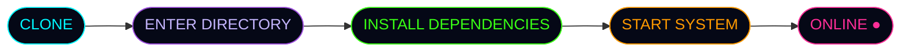

<div align="center">


<a href="https://github.com/sharifvau/Emon-Server">
  
</a>


**◈ A NEW DIMENSION OF DEVELOPMENT ◈**
<br />
<sub>ENGINEERED WITH PASSION · POWERED BY IMAGINATION</sub>

<br /><br />


<br /><br />


</div>


## ⌬ 01 // SYSTEM IDENTITY

> *«Not just a repository. A vision in motion.»*

**Emon-Server** is a development project maintained under the identity of **EMon-BHai**.

Built around experimentation, automation, and creative engineering, this project represents a continuous journey toward smarter digital tools.

```ansi
┌──────────────────────────────────────────────┐
│  SYSTEM ........ EMON-SERVER                 │
│  DEVELOPER ..... EMON-BHAI                   │
│  ENVIRONMENT ... NODE.JS                     │
│  MISSION ....... BUILD | CREATE | EVOLVE     │
│  STATUS ........ UNDER DEVELOPMENT  [●]      │
└──────────────────────────────────────────────┘
```


## ⌬ 02 // THE VISION

<div align="center">


</div>

<br />

| ◈ Core Principle | Description |
|---|---|
| **Automation First** | Exploring smarter ways to handle repetitive tasks |
| **Continuous Evolution** | Improving the project as development progresses |
| **Modular Thinking** | Building with maintainability and future expansion in mind |
| **Open Development** | Making source code accessible for learning and experimentation |

> *⚡ Built with passion. Driven by innovation. Inspired by the future.*

<sub>Actual functionality depends on the current source code.</sub>


## ⌬ 03 // TECHNOLOGY MATRIX

<div align="center">


<br />
<sub>NODE.JS · JAVASCRIPT · NPM · GIT · GITHUB</sub>

</div>


## ⌬ 04 // DEPLOYMENT PROTOCOL



**STEP 01 — Clone Repository**

```bash
git clone https://github.com/sharifvau/Emon-Server.git
```

**STEP 02 — Enter Project Directory**

```bash
cd Emon-Server
```

**STEP 03 — Install Dependencies**

```bash
npm install
```

**STEP 04 — Start the System**

If `index.js` is the project's entry point, run:

```bash
node index.js
```

> Check `package.json` for the correct startup command before running the project.


## ⌬ 05 // LIVE TELEMETRY

<div align="center">


</div>


## ⌬ 06 // DEVELOPER TERMINAL

<div align="center">

<a href="https://github.com/sharifvau">
  
</a>
<a href="https://github.com/sharifvau/Emon-Server">
  
</a>
<a href="https://facebook.com/EMon.BHai.FACEBOOK">
  
</a>

<br /><br />

**DEVELOPER: EMon-BHai**
<br />
<sub>CREATING TODAY · ENGINEERING TOMORROW</sub>

</div>


## ⌬ 07 // RESPONSIBLE USE

<details>
<summary>⚠️ DISCLAIMER & TERMS OF USE</summary>

<br />

This project is provided for educational and development purposes.

Users are responsible for complying with applicable laws and third-party platform terms of service.

The project owner is not responsible for misuse, unauthorized activities, or damages resulting from improper use.

</details>

<br />

<div align="center">

**「 THINK DIFFERENT. BUILD THE IMPOSSIBLE. 」**

<br />

`EMON-SERVER // END OF TRANSMISSION ⟢`

<br />

<sub>DESIGNED WITH PASSION BY EMON-BHAI</sub>


</div>
